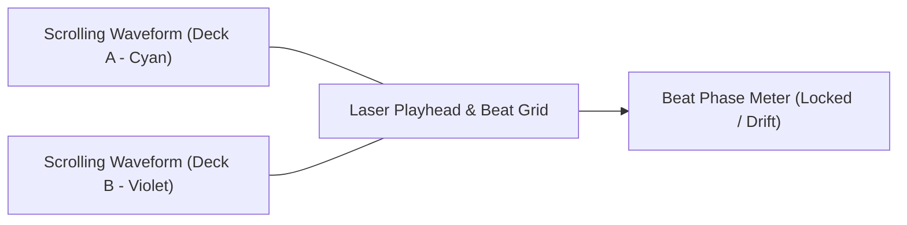
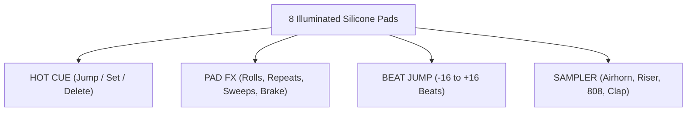
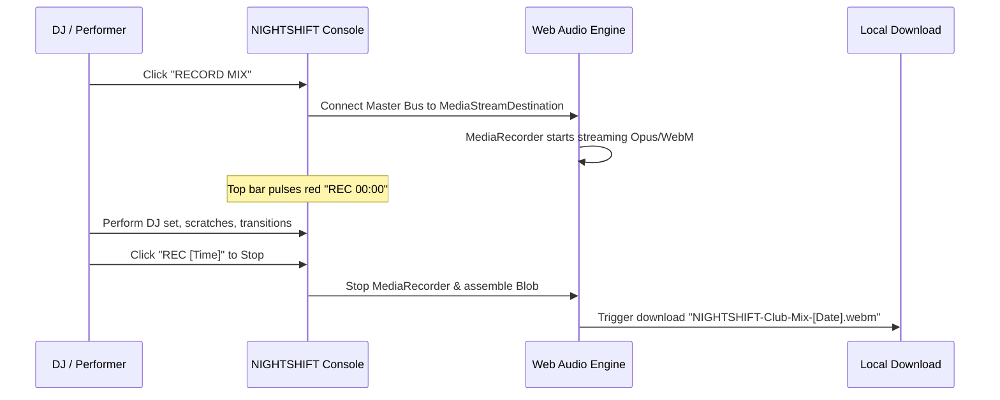

# NIGHTSHIFT — Complete User Manual & Performance Guide
### Modern Professional DJ Mixing Workstation


Welcome to the **NIGHTSHIFT** official user manual. NIGHTSHIFT is a club-grade, high-density DJ software application inspired by the industry-standard workflows of **Pioneer rekordbox**, **Serato DJ Pro**, and **VirtualDJ**, featuring an authentic dark futuristic visual identity optimized for nightclub booths, festivals, and home studio live streams.

---

## Table of Contents

1. [Quick Start & Installation](#1-quick-start--installation)
2. [Interface Architecture](#2-interface-architecture)
3. [Top Navigation & Status Bar](#3-top-navigation--status-bar)
4. [Waveform Display & Beat Matching](#4-waveform-display--beat-matching)
5. [Deck Controls & Turntable Platter](#5-deck-controls--turntable-platter)
6. [Looping & Performance Pads](#6-looping--performance-pads)
7. [Central Hardware DJ Mixer](#7-central-hardware-dj-mixer)
8. [Track Library & Audio Import](#8-track-library--audio-import)
9. [Step-by-Step DJ Mixing Guides](#9-step-by-step-dj-mixing-guides)
10. [Live Mix Recording & Export](#10-live-mix-recording--export)
11. [Master Keyboard Shortcuts](#11-master-keyboard-shortcuts)
12. [Troubleshooting & FAQ](#12-troubleshooting--faq)

---

## 1. Quick Start & Installation

### Prerequisites
- **Node.js**: v18.0.0 or higher (Node v20+ recommended)
- **Modern Web Browser**: Google Chrome, Brave, Microsoft Edge, or Mozilla Firefox (with Web Audio API support)
 

### Installation
Clone the repository and install dependencies:

```bash
# Clone the repository
git clone https://github.com/your-username/nightshift-dj.git

# Navigate into the project folder
cd nightshift-dj

# Install dependencies
npm install

# Start the local development server
npm run dev
```

Open your browser and navigate to:
```
http://localhost:5173/
```

> [!TIP]
> Press **F11** in your browser to enter Full Screen Mode for the ultimate immersive desktop DJ console experience.

---

## 2. Interface Architecture

NIGHTSHIFT's layout is engineered with high ergonomic density:

```
┌─────────────────────────────────────────────────────────────────────────────┐
│                            TOP NAVIGATION BAR                               │
│  [Logo] [View Tabs]       [Audio Specs] [REC MIX] [Clock]       [DSP] [Win] │
├─────────────────────────────────────────────────────────────────────────────┤
│                    STACKED SCROLLING WAVEFORM DISPLAY                       │
│  DECK A (Cyan)   ═══════════════════[ Playhead ]═══════════════════════     │
│  BEAT PHASE METER ───────────────[ LOCKED ]───────────────                  │
│  DECK B (Violet) ═══════════════════[ Playhead ]═══════════════════════     │
├──────────────────────┬───────────────────────────────┬──────────────────────┤
│    DECK A (CYAN)     │       CENTRAL DJ MIXER        │    DECK B (VIOLET)   │
│                      │                               │                      │
│ • Header & BPM       │ • Master & Booth Knobs        │ • Header & BPM       │
│ • Needle Overview    │ • Master Stereo VU Meters     │ • Needle Overview    │
│ • Jog Wheel / Platter│ • Trim / Gain Controls        │ • Jog Wheel / Platter│
│ • Pitch Fader        │ • 3-Band Isolator EQ + Kills  │ • Pitch Fader        │
│ • Auto-Loop Bar      │ • Sound Color FX Filters      │ • Auto-Loop Bar      │
│ • Performance Pads   │ • Channel Faders & VU Meters  │ • Performance Pads   │
│ • Cue / Play / Sync  │ • Crossfader & Curve Selector │ • Cue / Play / Sync  │
├──────────────────────┴───────────────────────────────┴──────────────────────┤
│                      TRACK LIBRARY & CRATE BROWSER                          │
│ [Crates Sidebar]  [Search & Camelot Match Filter]  [Track Table with Load]  │
└─────────────────────────────────────────────────────────────────────────────┘
```

---

## 3. Top Navigation & Status Bar

The top bar gives you instant feedback and session controls:

- **Branding & Mode Navigation**:
  - `PERFORMANCE`: Full dual-deck view with stacked waveforms and mixer.
  - `SPLIT DECK`: Maximized deck view.
  - `LIBRARY`: Maximized crate and track browser view for building playlists before or during a gig.
- **DSP Audio Engine Specs**: Displays live sample rate (`48.0 kHz`), audio buffer latency (`2.1 ms`), and DSP engine status.
- **RECORD MIX Console**:
  - Click **RECORD MIX** to start capturing your master audio output.
  - Pulsating red tally light displays elapsed recording time (`REC 04:12`).
  - Clicking again stops recording and triggers an immediate high-quality `.webm` audio download.
- **Master Level Indicator**: Displays current Master Volume output percentage.
- **Session Clock**: Real-time 24-hour clock to keep track of set times in the booth.
- **DSP Load Meter**: Real-time monitoring of audio engine CPU utilization.
- **Shortcuts & Settings**: One-click access to the keyboard cheatsheet (<kbd>?</kbd>) and hardware audio preferences (<kbd>⚙</kbd>).

---

## 4. Waveform Display & Beat Matching

The central waveform section provides visual alignment tools identical to flagship Pioneer CDJ-3000 setups and Serato DJ Pro:



### 3-Band Spectrum Waveforms
The waveform displays three distinct frequency layers:
- **Red / Warm Magenta**: Sub-bass, 808s, and kick drum fundamental frequencies.
- **Cyan / Green**: Mid-range frequencies, vocals, snare drums, and synth leads.
- **Electric Cyan / Bright Violet**: High frequencies, hi-hats, cymbals, and transients.

### Beat Grid Lines & Bar Numbers
- Vertical grid lines mark every beat.
- Prominent grid lines mark the start of each 4-beat bar with bar numbering (`1`, `2`, `3`, `4...`).

### Pioneer-Style Beat Phase Meter
Located in the center header between Deck A and Deck B waveforms:
- When both tracks are playing, the indicator bar shows whether Deck B's beats are **rushing** (ahead) or **dragging** (behind) Deck A.
- When both beats align at the exact same millisecond, the indicator snaps to center and illuminates a neon green **`LOCKED`** badge.

### Waveform Navigation
- **Zoom Controls**: Use the `+` and `-` buttons (or click the zoom readout) to scale from **60% to 200%** zoom.
- **Direct Scratch Scrubbing**: Click and drag directly on the waveform to scrub through the audio with real-time audio playback.

---

## 5. Deck Controls & Turntable Platter

Each deck features an authentic CDJ / turntable workflow:

### Platter & Jog Wheel
- **Vinyl Grooves & Radial Reflection**: Realistic spinning platter running at true-to-tempo rotation speed.
- **Touch Drag-Scratching**:
  - Click and drag anywhere on the vinyl platter to scratch back and forth.
  - Web Audio engine dynamically modulates pitch and playback rate to emulate authentic vinyl scratching.
- **Pitch Bend Nudge**:
  - Use the **`- BEND`** and **`+ BEND`** buttons underneath the platter (or keyboard shortcuts `[` / `]`) to temporarily speed up or slow down playback to align beats without touching the pitch fader.
- **Vinyl / CDJ Mode**: Toggle between classic touch-sensitive vinyl mode and pitch-bend wheel mode.

### Digital Readouts
- **BPM Counter**: High-contrast readout of the track's current tempo with 0.01 precision, plus original base BPM.
- **Pitch Percentage**: Real-time tempo offset display (e.g. `+1.25%`).
- **Musical Key & Camelot Code**:
  - Displays Camelot notation (e.g. `8A`) alongside standard musical notation (`Am`).
  - Color-coded badges indicate harmonic compatibility on the Camelot wheel.
- **Timecode Display**:
  - Click the time display to toggle between **Elapsed Time** and **Remaining Time** (remaining time flashes red when under 30 seconds).

### Transport Buttons
- **PLAY / PAUSE (Large Round Button)**:
  - Illuminates bright neon cyan (Deck A) or magenta (Deck B) when playing.
  - Flashes when paused at a cue point.
  - Shortcut: <kbd>Spacebar</kbd> (Deck A) / <kbd>Enter</kbd> (Deck B).
- **CUE Button**:
  - While stopped, sets the primary Cue point at the current playhead position.
  - While playing, pressing CUE immediately halts playback and returns the playhead to the Cue point.
  - Holding CUE previews audio from the Cue point until released.
  - Shortcut: <kbd>C</kbd> (Deck A) / <kbd>K</kbd> (Deck B).
- **SYNC Button**:
  - Synchronizes the deck's tempo and beat grid phase to match the Master deck instantly.
  - Shortcut: <kbd>S</kbd> (Deck A) / <kbd>B</kbd> (Deck B).
- **MASTER Button**: Designates this deck as the master tempo clock.
- **QUANTIZE (QTZ)**: Snaps your cue triggers and loop activations to the nearest beat grid line.
- **SLIP MODE**: The track silently continues playing in the background during scratches, loops, or reverse effects, seamlessly snapping back into rhythm when released.
- **KEY LOCK (Master Tempo)**: Preserves the original vocal and musical pitch when shifting the BPM up or down.

### Precision Pitch Fader
- **Adjustable Pitch Ranges**: Toggle between **`±8%`**, **`±16%`**, and **`±50%`** ranges.
- **Center 0.00% Detent LED**: High-visibility neon green LED lights up when the fader is locked at nominal 0.00% pitch.
- **Reset Button**: Click the circular reset button to instantly reset pitch to `+0.00%`.

---

## 6. Looping & Performance Pads

```
┌────────────────────────────────────────────────────────┐
│ [LOOP]   [IN] [OUT] [RELOOP/EXIT]   (Active: 4 BEATS)  │
│ [ 1/2 ]  [  1  ]  [  2  ]  [  4  ]  [  8  ]  [  16  ]  │
│ [ 1/2X Halve Length ]        [ 2X Double Length ]      │
└────────────────────────────────────────────────────────┘
```

### Auto-Looping
- Click any beat value button (`1/2`, `1`, `2`, `4`, `8`, `16`) to engage a seamless, sample-accurate loop.
- **`1/2X`**: Instantly cuts the active loop length in half (e.g. from 4 beats to 2 beats, down to 1/2 beat for build-up rolls).
- **`2X`**: Instantly doubles the active loop length (e.g. from 4 beats to 8 beats).
- **`IN` / `OUT`**: Create manual loop boundaries on the fly.
- **`EXIT / RELOOP`**: Jump out of an active loop, or re-engage the last active loop.

### Performance Pads (4 Distinct Modes)
Switch modes using the tabs at the top of the pad section:



1. **HOT CUE Mode**:
   - 8 distinct colored pads with time readouts.
   - Click an empty pad to set a Hot Cue at the current playhead position.
   - Click an active pad to jump instantly to that cue point with zero latency.
   - Toggle **`SHIFT`** and click a pad to delete an unwanted cue point.
   - Shortcuts: <kbd>1</kbd>–<kbd>8</kbd> (Deck A) / <kbd>Numpad 1</kbd>–<kbd>8</kbd> (Deck B).
2. **PAD FX Mode**:
   - `ROLL 1/16`, `ROLL 1/8`, `ROLL 1/4`, `ROLL 1/2`: Momentary stutter rolls that release back into the groove.
   - `REPEAT 1B`: 1-beat stutter repeater.
   - `HPF SWEEP` / `LPF SWEEP`: Instant filter sweeps for energetic transitions.
   - `BRAKE`: Emulates classic turntable motor power-down tape stop.
3. **BEAT JUMP Mode**:
   - Skip forward or backward by `-16`, `-8`, `-4`, `-1`, `+1`, `+4`, `+8`, or `+16` beats without losing the rhythm.
4. **SAMPLER Mode**:
   - Launch iconic club sound effects synthesized via Web Audio:
     - Pad 1: **Airhorn** (Dancehall 3-burst blast)
     - Pad 2: **Riser** (White noise bandpass sweep)
     - Pad 3: **Laser** (Retro arcade downward pitch sweep)
     - Pad 4: **808 Sub** (Deep 35Hz sub-bass drop)
     - Pad 5: **909 Hat** (Metallic open hi-hat)
     - Pad 6: **Clap** (Crisp club stereo handclap)
     - Pad 7: **Vocal Drop** (Harmonic formant chant)
     - Pad 8: **Rewind** (Turntable vinyl backspin)

---

## 7. Central Hardware DJ Mixer

The mixer operates between Deck A and Deck B:

### Channel Strips (Channel 1 / Channel 2)
- **Trim / Gain Rotary Knob**: Sets channel pre-amplification level (`-∞` to `+12dB`).
- **3-Band Isolator EQ**:
  - **HIGH**: Treble boost/cut (`-26dB` to `+6dB`).
  - **MID**: Mid-range vocal & instrument boost/cut (`-26dB` to `+6dB`).
  - **LOW**: Bass & sub-frequency boost/cut (`-26dB` to `+6dB`).
- **Instant KILL Switches**:
  - Next to each EQ knob is an instantaneous **KILL** button.
  - Pressing **KILL** drops that specific frequency band to `-60dB` silence instantly.
  - Shortcut: <kbd>Z</kbd> (Deck A Bass Kill) / <kbd>M</kbd> (Deck B Bass Kill).
- **Sound Color FX Filter**:
  - Center position (12 o'clock) is neutral bypass.
  - Turn **Counter-Clockwise** for Low Pass Filter (LPF) sweeping down to 250Hz.
  - Turn **Clockwise** for High Pass Filter (HPF) sweeping up to 6000Hz with resonant peak.
- **Headphone CUE (PFL)**: Pre-Fade Listen monitoring button.
- **Channel Level Fader**: Long-throw vertical volume slider.
- **Channel VU Meters**: 12-segment real-time LED ladder (Green: nominal, Amber: warm drive, Red: clipping).

### Master Section
- **Master Volume Knob**: Output gain to speakers and live recording.
- **Booth Volume Knob**: Independent DJ booth monitor level.
- **Headphone Volume & Cue Mix**: Adjusts headphone output and blends between Cue and Master audio.
- **Dual Master Stereo VU Meter**: Displays Left and Right master output levels with peak clip warnings.

### Crossfader
- **Crossfader Curves**:
  - **`SMOOTH`**: Equal-power trigonometric curve for gradual house, techno, and trance blends.
  - **`LINEAR`**: Linear volume transition.
  - **`SCRATCH`**: Ultra-sharp cut curve (full volume reached within 2mm of travel) designed for fast hip-hop cuts and beat juggling.
- **Hamster Switch (`HAMSTER (REV)`)**: Reverses crossfader orientation (Deck B on left, Deck A on right).
- **Crossfader Assign**: Route each channel to side `A`, side `B`, or `THRU` (bypasses the crossfader).
- Shortcuts: <kbd>← Left Arrow</kbd> (fade to Deck A) / <kbd>→ Right Arrow</kbd> (fade to Deck B).

---

## 8. Track Library & Audio Import

```
┌────────────────────────────────────────────────────────────────────────┐
│ [CRATES]         [Search by title, artist, key...] [HARMONIC MATCH 8A] │
│ 📁 All Tracks    ┌────┬──────────────────────┬─────┬─────┬──────┬────┐│
│ 📁 Tech House    │DECK│ TITLE / ARTIST       │ BPM │ KEY │ TIME │LOAD││
│ 📁 Acid Techno   ├────┼──────────────────────┼─────┼─────┼──────┼────┤│
│ 📁 Melodic House │ A  │ Nightshift (Club Mix)│128.0│ 8A  │02:00 │ A B││
│ 📁 Drum & Bass   │ B  │ Neon Horizon         │124.0│ 9B  │01:56 │ A B││
│ 📁 User Imports  │    │ Cyber Underground    │132.0│ 11A │02:08 │ A B││
│ [IMPORT AUDIO]   └────┴──────────────────────┴─────┴─────┴──────┴────┘│
└────────────────────────────────────────────────────────────────────────┘
```

### 1. Crates & Playlists
Organize your music into dedicated crates:
- **All Tracks**: Complete library collection.
- **Tech House**: Driving grooves (124–128 BPM).
- **Acid Techno Vault**: Warehouse acid sounds (130–136 BPM).
- **Melodic & Progressive**: Atmospheric chords (120–125 BPM).
- **Drum & Bass 174**: High-energy breakbeats (170–175 BPM).
- **Cyberpunk Synth**: Retrowave and synthwave grooves (116–122 BPM).
- **User Imports**: All tracks you have imported during this session.

### 2. Importing Your Own Audio Files
NIGHTSHIFT includes a built-in browser-based audio decoder:
1. Click the **`IMPORT AUDIO`** button in the lower left sidebar, or drag audio files directly into the window.
2. Supports **MP3, WAV, FLAC, AAC, and OGG** formats.
3. The audio engine decodes the audio in the background:
   - Calculates duration and sample rate.
   - Runs energy peak correlation to detect BPM automatically.
   - Computes multi-band 3-band RGB waveform data.
   - Automatically sets 3 starter Hot Cues.
4. Your track appears immediately in the table, ready to load onto Deck A or Deck B!

### 3. Harmonic Mixing with the Camelot Wheel
Harmonic mixing avoids dissonance when blending two songs:
- When a track is playing on Deck A, NIGHTSHIFT identifies its Camelot key (e.g. `8A`).
- Click **`HARMONIC MATCH (8A)`** in the toolbar to instantly filter the library to only display compatible tracks:
  - **Same Key**: `8A` (Perfect harmony)
  - **Relative Major/Minor**: `8B` (Natural emotional mood shift)
  - **Adjacent Keys**: `7A` or `9A` (Smooth 1-step energy transition)

---

## 9. Step-by-Step DJ Mixing Guides

### Tutorial 1: Your First Beatmatched Transition

1. **Load Deck A**: Click **`DECK A`** on *Nightshift (Club Extended)* (128 BPM, Key 8A).
2. **Start Playback**: Press <kbd>Spacebar</kbd> or click the large cyan **PLAY** button. Bring **Channel 1 Fader** up to maximum. Move the **Crossfader** all the way to the **left (A)**.
3. **Load Deck B**: Click **`DECK B`** on *Neon Horizon* (124 BPM, Key 9B).
4. **Sync the Tempos**:
   - Notice Deck A is 128.00 BPM and Deck B is 124.00 BPM.
   - Click the violet **`SYNC`** button on Deck B. Deck B's pitch slider moves automatically to match 128.00 BPM!
5. **Cue the Drop**:
   - On Deck B, press pad **`2`** under Hot Cues to jump straight to the drop intro, then pause.
6. **Drop Deck B on the Beat**:
   - Watch the bar counter on Deck A's waveform (`1`, `2`, `3`, `4`).
   - Exactly as Deck A hits beat `1` of the next 4-bar phrase, press <kbd>Enter</kbd> (Play on Deck B).
7. **Check the Beat Phase Meter**:
   - Look at the center **Beat Phase Meter**. If it says `LOCKED`, the kicks are hitting simultaneously!
   - If it drifts slightly, tap `- BEND` or `+ BEND` on Deck B to align the beats.
8. **Execute the Blend**:
   - Turn **Deck B's LOW EQ** down to 9 o'clock (prevents muddy bass clash).
   - Bring **Channel 2 Fader** up to 85%.
   - Slowly glide the **Crossfader** from Left toward Center.
   - Swap the basslines: Turn Deck A's **LOW KILL** on, and turn Deck B's **LOW EQ** up to 12 o'clock!
   - Slide the crossfader completely over to **Right (B)**. Press <kbd>Spacebar</kbd> to stop Deck A.
   - **Congratulations — you just completed a seamless club mix transition!**

---

## 10. Live Mix Recording & Export

NIGHTSHIFT can record your entire live performance directly to a high-quality audio file with zero setup:



1. Click **`RECORD MIX`** in the top navigation bar.
2. The tally light turns red and begins counting up (`REC 00:01`, `REC 00:02`...).
3. Perform your set, using scratches, loops, EQ kills, and samples.
4. When finished, click the red recording button again.
5. The audio engine packages the performance and your browser immediately downloads:
   ```
   NIGHTSHIFT-Club-Mix-2026-10-18-23-00-00.webm
   ```
6. The file is ready to share on SoundCloud, Mixcloud, or YouTube!

---

## 11. Master Keyboard Shortcuts

| Category | Action | Deck A (Cyan) | Deck B (Violet) |
| :--- | :--- | :--- | :--- |
| **Transport** | Play / Pause | <kbd>Spacebar</kbd> | <kbd>Enter</kbd> |
| | Return to Cue Point | <kbd>C</kbd> | <kbd>K</kbd> |
| | Beat & Tempo Sync | <kbd>S</kbd> | <kbd>B</kbd> |
| **Pitch & Nudge** | Temporary Pitch Bend Down | <kbd>[</kbd> | <kbd>-</kbd> |
| | Temporary Pitch Bend Up | <kbd>]</kbd> | <kbd>=</kbd> |
| **EQ Kills** | Instant Bass (Low) Kill | <kbd>Z</kbd> | <kbd>M</kbd> |
| **Performance Pads** | Trigger Hot Cues 1 through 8 | <kbd>1</kbd>, <kbd>2</kbd>, <kbd>3</kbd>, <kbd>4</kbd>, <kbd>5</kbd>, <kbd>6</kbd>, <kbd>7</kbd>, <kbd>8</kbd> | <kbd>Numpad 1</kbd> through <kbd>8</kbd> |
| **Mixer** | Crossfader Shift Left / Right | <kbd>← Left Arrow</kbd> | <kbd>→ Right Arrow</kbd> |
| **Dialogs** | Open Keyboard Cheatsheet | <kbd>?</kbd> (Help Icon) | <kbd>?</kbd> (Help Icon) |
| | Hardware Preferences | <kbd>⚙</kbd> (Gear Icon) | <kbd>⚙</kbd> (Gear Icon) |

---

## 12. Troubleshooting & FAQ

### Q1: I clicked Play but there is no sound!
**A:** Modern browsers require an initial user interaction (such as clicking anywhere on the screen) before initializing the Web Audio API context. Click any button or dial on NIGHTSHIFT, check your computer's audio output volume, and verify the **Channel Faders** and **Master Volume** knobs are turned up.

### Q2: How do I load my own music?
**A:** Click **`IMPORT AUDIO`** in the bottom-left sidebar of the track library. You can select single or multiple MP3, WAV, FLAC, AAC, or OGG files from your hard drive. NIGHTSHIFT analyzes their tempo and waveforms in seconds.

### Q3: How do I scratch without losing my place in the song?
**A:** Activate **`SLIP MODE`** on the deck. When SLIP is enabled, you can scratch the jog wheel as much as you like; the moment you release the platter, playback instantly jumps to where the song would have been if you had never touched it.

### Q4: Can I use NIGHTSHIFT on a laptop without a mouse?
**A:** Yes! The entire mixing workflow can be driven using the keyboard shortcuts outlined in [Section 11](#11-master-keyboard-shortcuts).

---

## License & Credits

- Designed & Built for modern DJ workflows.
- Powered by React 19, TypeScript, Tailwind CSS, Lucide React, and the Web Audio API.
- Licensed under the **MIT License**. Free for personal and commercial performance use.

